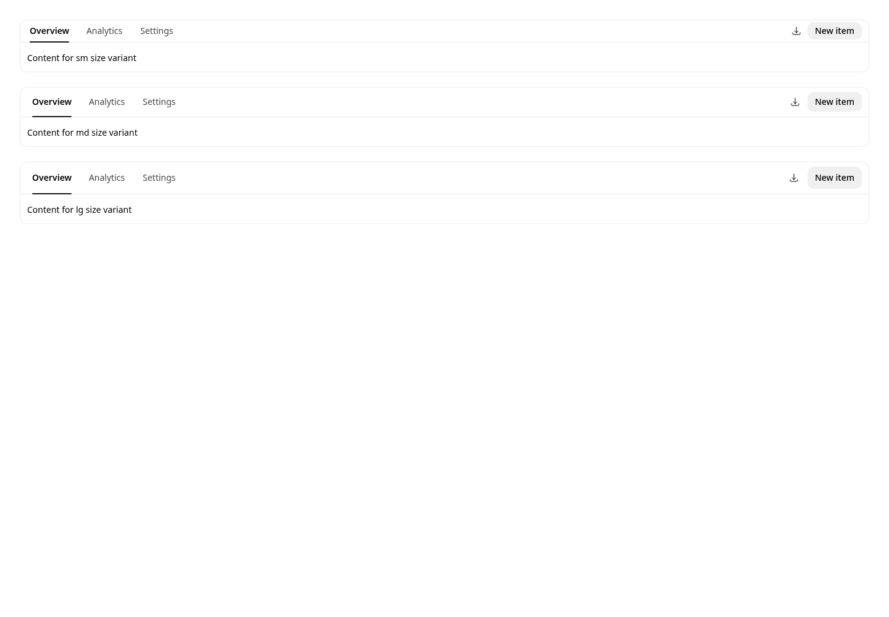
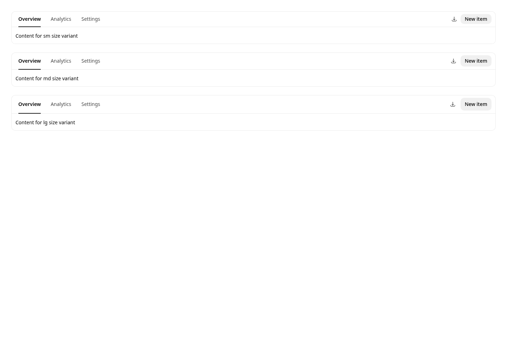

# Core Toolbar pre-#6954 restoration evidence

This matrix compares the compact Toolbar behavior currently on `main` with the proposed restoration. Both sides use the same 1440 × 1000 Chromium viewport and neutral/light/LTR Storybook globals.

- **Before source:** Astryx `6ecd41722788031aec349c3676ac4ab3f7d2dc4c`
- **After source:** Astryx `9368c86f` (the Core-only restoration commit)
- **Changed state:** `sm` block padding returns from 4px to 8px.
- **Preserved states:** Section/theme-owned inline padding remains 12px in this theme; `md` and `lg` remain at 8px block padding; controls continue to inherit Toolbar size.
- **Machine-readable measurements:** [`geometry.json`](./geometry.json)

## Compact

| Before — 4px block padding | After — 8px block padding |
| --- | --- |
|  |  |

## Card header composition

| Before — 4px block padding | After — 8px block padding |
| --- | --- |
|  |  |

## Size cascade matrix

| Before | After |
| --- | --- |
|  |  |
