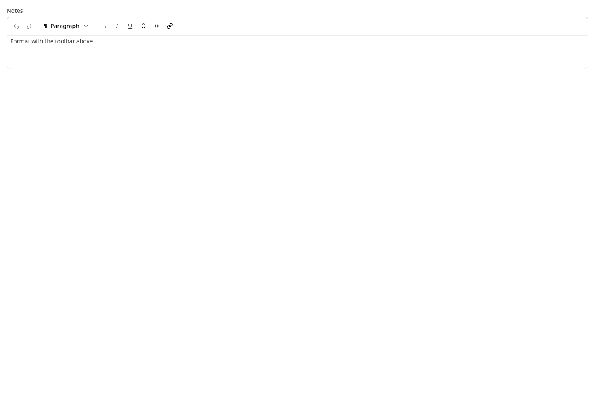
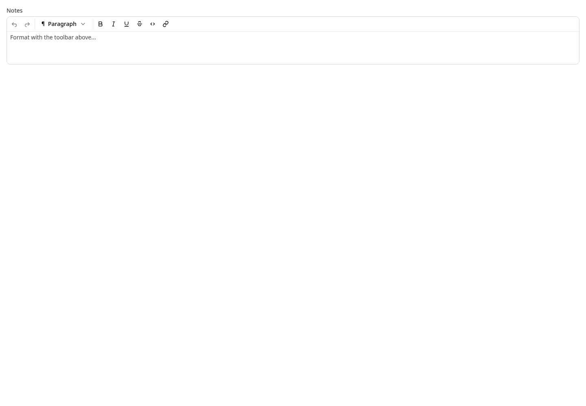
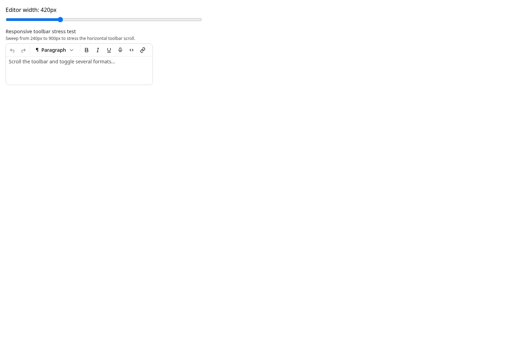

# RichTextEditorToolbar-local 4px gutter evidence

This matrix compares the Core-restoration parent with the RichText-only child. Both sides use the same 1440 × 1000 Chromium viewport and neutral/light/LTR Storybook globals.

- **Before source:** Astryx `9368c86fba170ac0185fb892da5178bf59ba8dcd` (Core restore parent)
- **After source:** Astryx `c725c28ba6d66d672092dafaeb86591c33664a0d` (RichText-only child; gutter declarations emitted through StyleX)
- **Changed state:** RichText formatting controls move from an 8px visual gutter to 4px on every edge; the compact editor becomes 8px shorter.
- **Preserved state:** Generic Core `Toolbar / Compact` is pixel-identical before and after (matching SHA-256 values in `geometry.json`).
- **Machine-readable measurements:** [`geometry.json`](./geometry.json)

The implementation remains local to RichText: Section-owned inline variables narrow its inline inset, while the transparent Toolbar wrapper overlaps 4px of Core Toolbar's retained 8px block inset. Core Toolbar source and geometry do not change in this child.

## With Toolbar

| Before — 8px visual gutter | After — 4px visual gutter |
| --- | --- |
|  |  |

## Responsive toolbar

| Before | After |
| --- | --- |
|  |  |

## Responsive stress test

| Before | After |
| --- | --- |
|  |  |

## Representative unchanged Core path

| Parent | Child |
| --- | --- |
|  |  |
